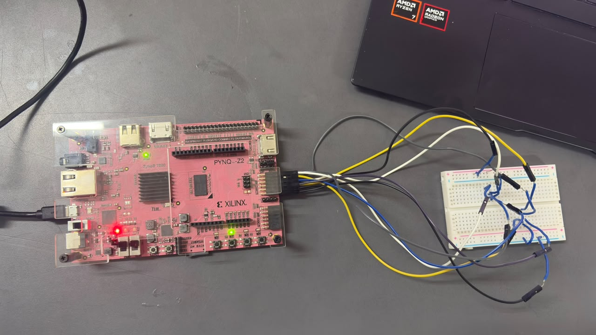

# Basic-Blocks-on-PYNQZ2

Basic Combinational blocks actually wired up and tested on a PYNQ-Z2 board, with testbenches and xdc files.

## Hardware Setup

## What's Inside

- `full_adder_4bit/` — 4-bit Ripple Carry Adder (`adder_4bit.v`), testbench (`tb_adder_4bit.v`), and constraints (`adder.xdc`)
- `mux_8x1/` — 8-to-1 MUX (`mux8to1.v`), testbench (`tb_mux8to1.v`), and constraints (`mux.xdc`)
- `docs/` — PYNQ-Z2 hardware setup photo
